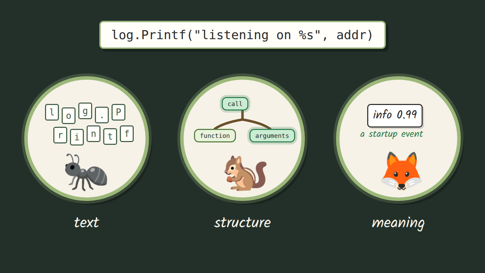
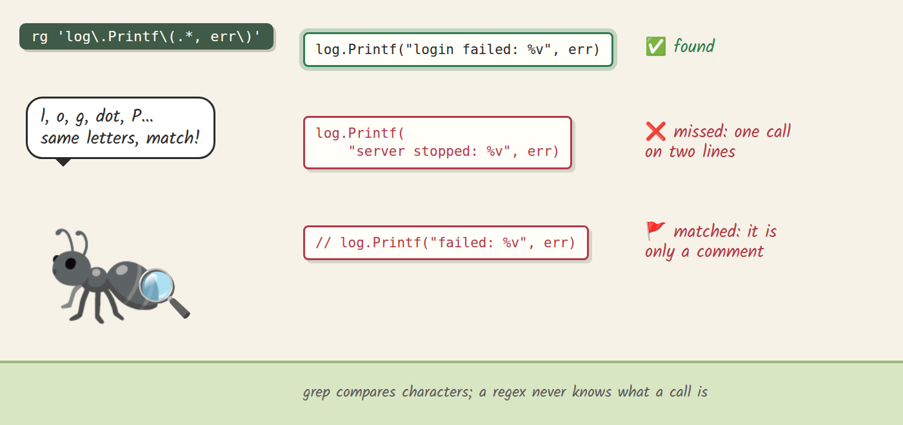
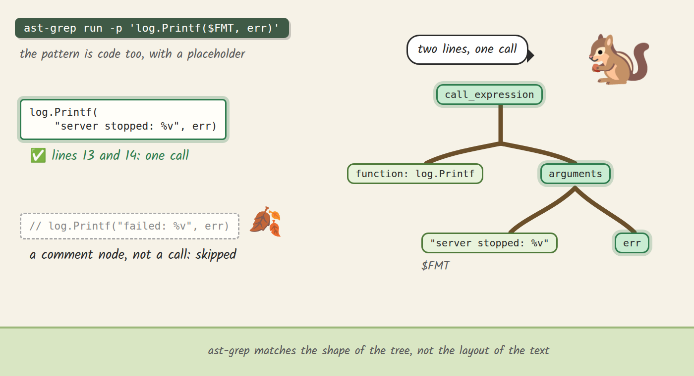
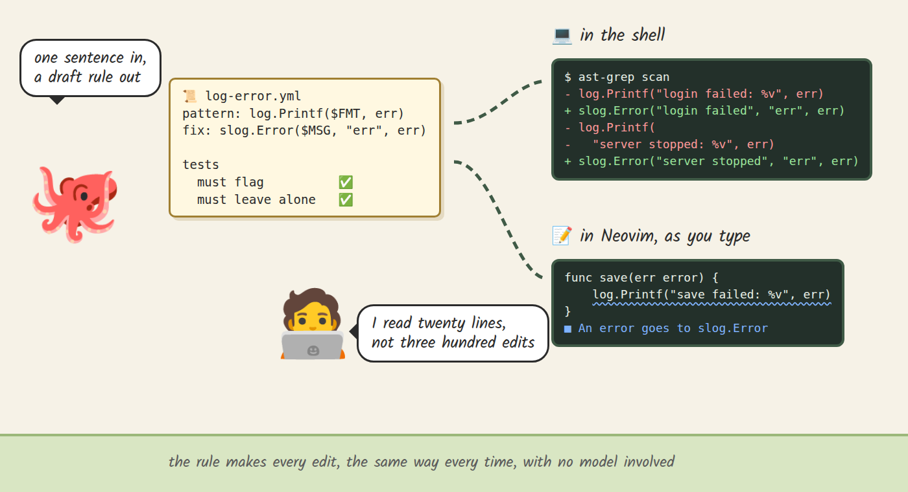

import ReactPlayer from 'react-player';



<style>{`
  article img:not(:first-of-type) {
    max-width: 700px;
    height: auto;
  }
  @media (max-width: 996px) {
    html.blog-post-page:has(img[alt="Three readers looking at the same line of code: one sees letters, one sees a tree, one sees what the line is for"]) .main-wrapper {
      width: 100% !important;
      max-width: 100% !important;
      margin: 0 !important;
      padding: 0 !important;
    }
    html.blog-post-page:has(img[alt="Three readers looking at the same line of code: one sees letters, one sees a tree, one sees what the line is for"]) .container.margin-vert--lg {
      width: calc(100% - 24px) !important;
      max-width: 100% !important;
      margin: 0 12px !important;
      flex-shrink: 0;
      padding: 36px 0 0 !important;
    }
    html.blog-post-page:has(img[alt="Three readers looking at the same line of code: one sees letters, one sees a tree, one sees what the line is for"]) main.col.col--7 {
      width: 100% !important;
      max-width: 100% !important;
      padding: 24px 16px !important;
    }
    html.blog-post-page:has(img[alt="Three readers looking at the same line of code: one sees letters, one sees a tree, one sees what the line is for"]) .markdown :is(pre, table) {
      max-width: 100%;
      overflow-x: auto !important;
    }
  }
`}</style>

## Introduction

Every codebase eventually needs the same change in many places: a library swap, an API that changed shape, a convention the team agreed on last week. You know the usual options. Find and replace sees only text. Doing it by hand works for ten places and falls apart at three hundred. An AI assistant will happily make all three hundred edits, and then someone has to review each one.

In this blog, we will look at three tools that read code at three different levels. grep reads text. ast-grep reads structure, the syntax tree your editor already builds. A small local model, asked through classif, reads meaning. They are separate tools, each takes the part of the job it can see, and the interesting part is where each one stops.

<!--truncate-->

The running example is a change many Go teams face: moving a service from `log.Printf` to `log/slog`, the structured logger that has been in the standard library since Go 1.21. With slog, every value you log gets a name you can filter on, so `log.Printf("login failed: %v", err)` becomes `slog.Error("login failed", "err", err)`. Don't worry if you don't write Go. The example is small, and the ideas carry over to any language ast-grep supports.

### Who is this blog for?

If you have ever written a regex to find some code and then patched it three times, or scrolled through a long AI-generated diff wishing the change had one source you could read, this blog is for you. You don't need any compiler background; I will explain syntax trees when we get there.

By the end of this blog, you will know how to search and rewrite code by its structure with ast-grep, how to keep a rewrite as a tested rule that runs in the shell and in Neovim, and where a local model's judgment helps and where it cannot be trusted alone.

The post goes with my video on the same topic. The rules, examples and scripts live in [the video's repository](https://github.com/Piotr1215/youtube/tree/main/nvim-luasnip-ai-alternative), so you can run everything below yourself.

<ReactPlayer
  controls
  src='https://youtu.be/RqKfaoEvlNY'
  style={{ width: '100%', height: 'auto', aspectRatio: '16 / 9' }}
/>

## Three ways to read code

### #1 Text: grep

grep compares characters. That makes it fast and predictable, and it's the first tool most of us reach for. I use ripgrep, `rg`, but any grep behaves the same here. Ask it for every `log.Printf` and it finds them all instantly.

The trouble starts when the question is about code rather than letters. Say we want only the calls that log an error, because those have an obvious slog replacement. The example file has three of them, written the way real code ends up: one on a single line, one split over lines 13 and 14, and one commented out on line 15. Here is the regex you would write first, and what it returns:

```text
$ rg -n 'log\.Printf\(.*, err\)' examples/calls.go
12:	log.Printf("login failed: %v", err)
15:	// log.Printf("failed: %v", err)
```

It found one real call, missed the split one, and matched a line that is only a comment. You can patch the regex for each case: let it span lines, skip lines that start with `//`. Every new layout needs another patch, though, because a regex never knows what a call is. To grep, code is a stream of characters, and the same call can be spelled with many different characters.

[](_media/diagrams/ast-grep-level-1.png)

### #2 Structure: syntax trees and ast-grep

To see code instead of characters, we read it the way a compiler does, as a syntax tree. A call becomes a node with two children: the function it calls and its list of arguments. Line breaks and spacing don't change the tree, and a comment becomes a comment node, nowhere near a call.

Your editor already builds this tree. Neovim parses code with Tree-sitter, and `:InspectTree` opens the tree beside the buffer. Move the cursor through the split call and the whole call lights up across both lines, while the commented line shows as a comment. If you have never opened it, try it on your own code.

[ast-grep](https://ast-grep.github.io/) searches that tree, and here is the neat part: you write the search as code. You write the code you want to find, with a placeholder where it may differ:

```text
$ ast-grep run -p 'log.Printf($FMT, err)' examples/calls.go
examples/calls.go:12:	log.Printf("login failed: %v", err)
examples/calls.go:13:	log.Printf(
examples/calls.go:14:		"server stopped: %v", err)
```

ast-grep parses the pattern too, so it matches by shape. `$FMT` stands for any single argument, and `err` has to be exactly `err`. The split call is one call in the tree, so it's found. The comment isn't a call at all, so it's skipped. No regex patching required.

[](_media/diagrams/ast-grep-level-2.png)

### Rules: a search you keep

Finding is half the job. The placeholders remember what they matched, so the new line can be built from the old one: the message without its format verb, and the error as a named field. You could rewrite on the spot with `ast-grep run -r`, but a search is gone once it has run. The next time someone writes `log.Printf("...: %v", err)`, you are back where you started.

So we write it down as a rule. A rule is a small YAML file that holds the pattern, the limits on what the placeholders may match, how to reshape them, and the fix. This is the whole error rule from the repository:

```yaml
id: log-error
language: go
severity: info
message: An error goes to slog.Error
rule:
  pattern: log.Printf($FMT, err)
  inside:
    kind: expression_statement
constraints:
  FMT:
    regex: '^"[^%]*%(\+v|[vsd])[^%]*"$'
transform:
  BARE:
    replace:
      source: $FMT
      replace: '\s*%[-+# 0-9.]*[a-zA-Z]'
      by: ''
  MSG:
    replace:
      source: $BARE
      replace: ':"$'
      by: '"'
fix: 'slog.Error($MSG, "err", err)'
```

Read it top to bottom. Match `log.Printf($FMT, err)` when it stands as a statement, and only when the format string holds a single plain verb (`%v`, `%+v`, `%s` or `%d`). Strip the verb, then the trailing colon. Write `slog.Error` with the cleaned message and the error as a named field. `ast-grep scan` runs the rule over a file or a whole service and shows each change as a diff before anything is written, so `log.Printf("login failed: %v", err)` becomes `slog.Error("login failed", "err", err)`, and the split call becomes one tidy line too.

Because the rule is a file, you can read it, commit it and share it with your team. It also gets tests. Next to each rule sits a test file listing code the rule must flag and code it must leave alone, such as `log.Printf("read failed: %q", err)`, where slog would lose the quoting. `ast-grep test` runs them all, so an edit that breaks a rule fails before it touches your code. All 17 rule tests in the repository pass.

Not every line can be rewritten by a rule, and that's fine. slog keeps the value but not printf formatting, so a `%x` line would lose its hex. A second rule flags those lines for a person instead of letting them slip by unseen.

Writing rules takes practice, and this is where an AI assistant earns its place. In the repository, Claude drafted a working rule and its tests from one sentence asking for exactly this rewrite, and `ast-grep test` passed. That was one recorded run, so I wouldn't promise that every draft comes out right. What matters is what you review. You don't trust the draft: you run its tests and read twenty lines of YAML, instead of reviewing three hundred edits. From then on the rule makes every edit, the same way every time, with no model involved.

The same rules run in your editor. ast-grep ships a language server, and with it Neovim underlines every line a rule flags, with the fix one code action away. Write a new `log.Printf` with an error tomorrow and it's flagged as you type, so the change you made once stays made. The repository's [demo-init.lua](https://github.com/Piotr1215/youtube/blob/main/nvim-luasnip-ai-alternative/demo-init.lua) shows the setup: it enables the `ast_grep` server from nvim-lspconfig, which reads the rules through the project's `sgconfig.yml`.

[](_media/diagrams/ast-grep-level-rules.png)

### #3 Meaning: a local model's answer

Once the error lines are done, the lines left over look the same to the tree. Here are three from the example service: `log.Printf("got here %v", r.URL)`, `log.Printf("listening on %s", addr)` and `log.Printf("retrying in %v", backoff)`. Each one is a call with a message and a value, `log.Printf($FMT, $ARG)`, yet each needs a different change. The first is a debug print someone forgot, and it should go. The second is a startup event, and it should become `slog.Info`. The third could be either. What sets them apart is what each line means, and no pattern can see that.

Telling what text means is what language models are good at. The catch is that a chat model answers in free text and likes to rewrite code along the way, which is exactly what we wanted to avoid. [classif](https://github.com/Piotr1215/classif) is a small tool I built for this case. It asks a model on your own machine one question, and the model may only answer from your list: `debug` or `info`, or yes or no. Each answer comes with a score. I wrote about how it works in [classif: A Bridge Between Code and Semantic Reasoning](/blog/classif-semantic-decisions), so here I'll focus on how it meets the rules.

The question lives in the rule, next to the fix each answer points to. Two rules match these lines: `log-debug`, whose fix removes the line, and `log-info`, whose fix writes `slog.Info`. Each carries its own answer in its metadata:

```yaml
metadata:
  choose: What is this log line for?
  option: >-
    info=an event someone operating the service wants in the logs, like
    startup, a sign-in, a request outcome or a duration
  min_p: 0.85
```

A small script, `triage.sh`, sits between ast-grep and classif. It reads ast-grep's findings as JSON, asks the question once per call with both answers on the list, and lets the answer pick which rule's fix to suggest. ast-grep still builds every fix; the model only picks one. Here is the run on those three lines, with the Winnow 12B model on a 12 GB laptop GPU:

```text
$ ast-grep scan --json=stream --include-metadata examples/shape.go | ./triage.sh --pick
✓ examples/shape.go:11  log.Printf("got here %v", r.URL)  debug 0.96
    fix › (the line is removed)
✓ examples/shape.go:12  log.Printf("listening on %s", addr)  info 0.99
    fix › slog.Info("listening on", "addr", addr)
✗ examples/shape.go:13  log.Printf("retrying in %v", backoff)  debug 0.72 unsure
    left for a person
```

The retry line came back at 0.72, below the 0.85 floor set in the rule, so no fix is suggested and it waits for a person. That's my favorite row of the three.

A second question looks at the same lines from another side: does the value hold a secret or personal data? A line can be a perfectly good event and still print an email address. A third rule asks that question of every match, and a yes holds back every fix. On `log.Printf("user %v logged in", creds.Email)` the model picked `info` at 0.92, but the personal-data question came back yes at 0.99, so the line goes to a person with no fix at all.

[](_media/diagrams/ast-grep-level-3.png)

With the model already loaded, each question took about a quarter of a second on my machine, and the code never left it.

## How the pieces fit

The diagram below follows one call through the meaning check. ast-grep finds the call and builds every possible fix. triage.sh asks classif the rule's question, then the personal-data question, and only an answer that is sure enough, with no veto, picks a fix. Everything else is left for a person, including a model that is down or gives no answer.

[](_media/diagrams/ast-grep-meaning-sequence.png)

_[Open the diagram full size](_media/diagrams/ast-grep-meaning-sequence.png)_

## Where each one stops

grep stops at layout. It answers questions about characters, which is perfect for prose, logs and plain strings, and fragile the moment the same code can be written in more than one way.

ast-grep stops at meaning. It answers any question you can phrase as a shape, and it answers it the same way every time. Two lines with the same shape and different purposes look identical to it.

The model stops at what it can see, and this is the part to take seriously. Its score ranks the answers against each other, and a high score can still be wrong. In the video I describe a 0.96 as the model being 96% sure; the test below is why I now read the score as a ranking instead. The repository keeps a harder test: twenty pairs of identical log lines placed in different functions, written by an agent that never saw the rules, with that agent's intent as the answer key. On those 40 lines, measured on 2026-10-17 (I read these results and did not rerun them for this post), Winnow 12B picked the right label 25 times, and 6 of its wrong answers scored above the 0.85 floor. A larger 35B model on a Mac got 32 right. Whether a line is a leftover often lives only in its author's head, and no score can recover it from the code.

The personal-data question is different in kind: whether a value is an email address is written in the code the model reads. I expect it to hold up better, but I haven't yet measured it on real log lines a person labelled, so for now that part is my expectation. The rule of thumb I took from all this: ask the model about what the code shows, not about what its author meant, and read its answers as suggestions.

Put together, here is how I pick:

| Tool | Reads | Reach for it when | It stops at |
|------|-------|-------------------|-------------|
| grep | characters | the text itself is the question | the same code written another way |
| ast-grep rule | the syntax tree | you can describe the change by its shape | lines with the same shape and different purposes |
| local model via classif | what a line means | every possible change can be written as a rule, but structure cannot pick between them, and a wrong pick is easy to catch in the diff | facts that live outside the code it reads |

## Conclusion

Rules fit any change you can describe by its shape: a library swap, a review comment you keep writing, a pattern your team has banned. A model's question fits only where a person would decide by reading the code in front of them, and where a wrong answer costs you a second look at a diff.

What I find most compelling is how the model shows up here. We usually treat a language model as an external service: you send it a prompt and get prose back. A small classifier that may only pick from your list, answers in a fraction of a second, and runs on your own GPU behaves more like a building block. You can slot it into a deterministic program, here a set of ast-grep rules, at exactly the point where structure runs out.

I made the video and this post partly as a counterweight to a feeling I hear from a lot of engineers lately: that there is no point learning tools anymore, because AI will do everything faster and cheaper. Economically, that may even be true for some work. I still find real value in understanding what my tools see. It keeps me in control of the change, and it lets me use AI as one more tool on the belt.

Benefits:

- A rule is one file you can read, test and commit, and it makes the same edit every time
- The same rule runs from the shell and in your editor as you type
- An AI assistant can draft the rule while its tests check the draft, so you review twenty lines instead of hundreds of edits
- A local model adds a judgment on meaning in about a quarter of a second per question, without your code leaving the machine

Challenges:

- ast-grep's patterns, constraints and transforms take practice; the [playground](https://ast-grep.github.io/playground.html) and the [rule guide](https://ast-grep.github.io/guide/rule-config.html) help
- slog keeps values but not printf formatting, so some lines always need a person
- A high score can still be a wrong answer, and questions about intent are weak
- The classif part needs Ollama and a GPU that can hold a 12B model; the [classif README](https://github.com/Piotr1215/classif) covers the setup

To try it, you need [ast-grep](https://ast-grep.github.io/guide/quick-start.html) for the rules, Neovim with nvim-lspconfig for the editor part, and Ollama with classif for the meaning check. Clone the repository, change into `nvim-luasnip-ai-alternative`, and every command above runs as shown. If you are not sure where to start, pick a review comment you keep writing, and make it a rule.
