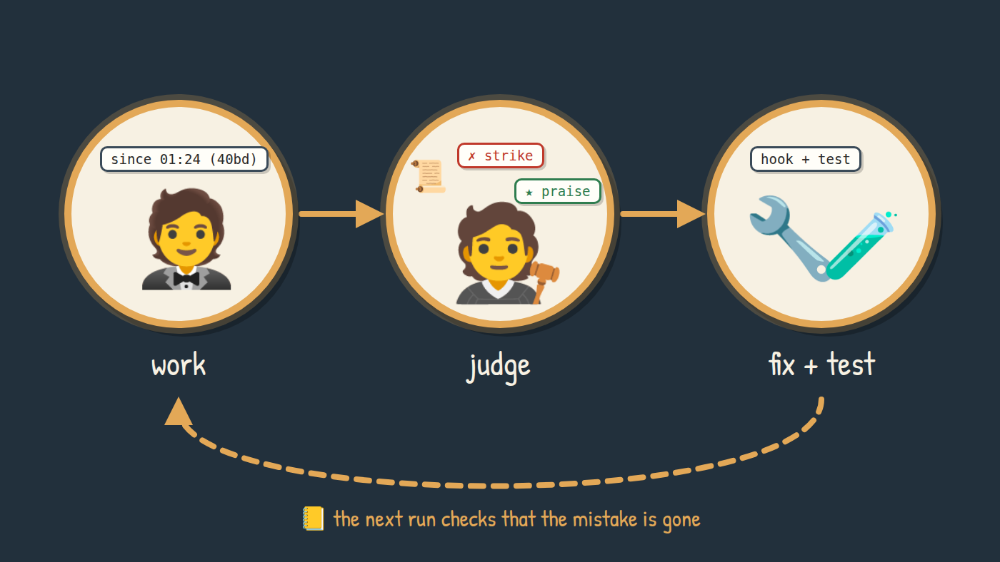
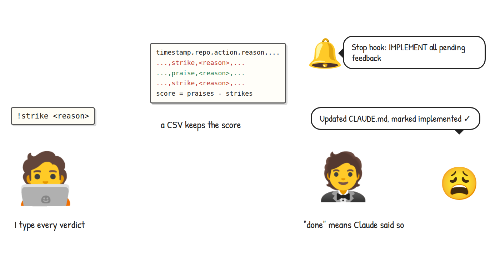
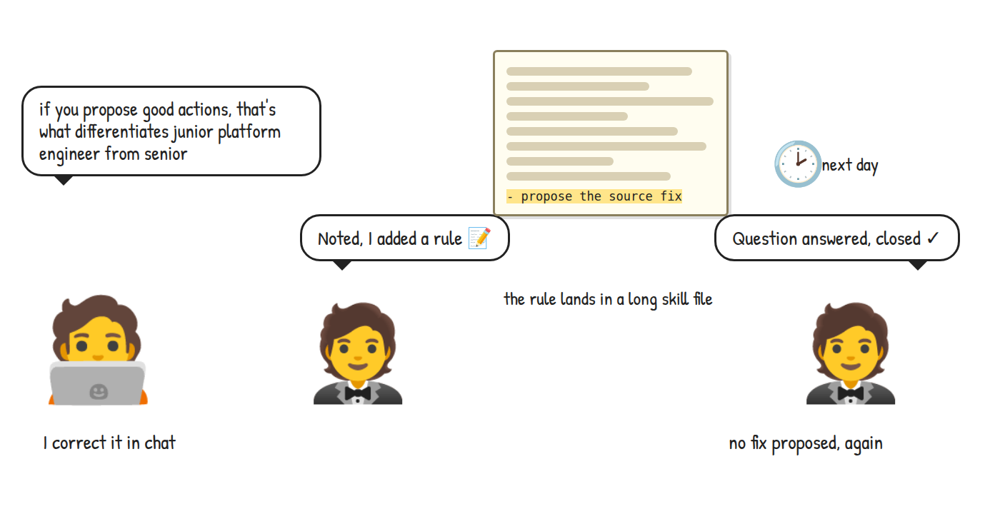

<style>{`
  article img:not(:first-of-type) {
    max-width: 700px;
    height: auto;
  }
  @media (max-width: 996px) {
    html.blog-post-page:has(img[alt^="Gordon works, a judge hands out"]) .main-wrapper {
      width: 100% !important;
      max-width: 100% !important;
      margin: 0 !important;
      padding: 0 !important;
    }
    html.blog-post-page:has(img[alt^="Gordon works, a judge hands out"]) .container.margin-vert--lg {
      width: calc(100% - 24px) !important;
      max-width: 100% !important;
      margin: 0 12px !important;
      flex-shrink: 0;
      padding: 36px 0 0 !important;
    }
    html.blog-post-page:has(img[alt^="Gordon works, a judge hands out"]) main.col.col--7 {
      width: 100% !important;
      max-width: 100% !important;
      padding: 24px 16px !important;
    }
    html.blog-post-page:has(img[alt^="Gordon works, a judge hands out"]) .markdown :is(pre, table) {
      max-width: 100%;
      overflow-x: auto !important;
    }
  }
`}</style>

## Introduction

In this blog, I will show a loop in which my AI assistant improves its own harness, and how the loop decides whether a change was actually an improvement.

<!--truncate-->

Gordon is a Claude Code session I keep running all day as my assistant. It reads my Slack, Linear and GitHub notifications, keeps my task board in TaskWarrior, drafts replies for me to send, and hands bounded work to short-lived worker agents. Like any assistant, it makes mistakes. The ones that cost me are the mistakes it makes twice.

For a long time my answer was to correct Gordon in chat. It would apologize and write the lesson down: a line in `CLAUDE.md`, a rule in a skill, a memory. Often enough, it made the same mistake again a day later. The lesson existed as text, and text in a long prompt competes with everything else in that prompt.

I talked this problem through with Codex, and the framing that came out of that conversation is the spine of this post: the model is fixed, and the harness is mutable. I can't change the weights of the model Gordon runs on. I can change everything around it: the instructions, which context arrives and when, the memory, the tools, the hooks and the permissions. Two agents on the same model behave differently because their harnesses differ. A loop in which the agent keeps improving that harness, including the parts that do the improving, has a working name: Recursive Harness Self-Improvement, or RHSI.

Changing the harness is the easy part; an agent does it every time it adds a line to a prompt. The hard part is knowing whether the change made anything better. So my loop has three roles, kept apart on purpose:

- An observer collects evidence about what Gordon did
- An independent judge reads that evidence and hands out strikes and praise
- An improving agent, Gordon itself, works out what in its harness to change, makes the change and tests it

A change counts as an improvement only when a later run of the judge no longer finds the same mistake.

By the end of this blog, you will know how the loop evolved, how the three roles fit together, and what one strike looks like on its way from my complaint to a verified fix. You will also see the numbers after its first two days, including a fix that still does not hold.

### Who is this blog for?

If you run a long-lived coding agent such as Claude Code or Codex, as an assistant or for automation, this article is for you. The same goes if you maintain a growing pile of `CLAUDE.md` rules, skills and hooks and wonder which of them actually change behaviour. You don't need my setup to follow along; the ideas carry over to any agent that leaves a transcript.

A few terms we will use throughout:

- The harness is everything around the model: prompts, skills, context injection, memory, hooks, tools, MCP servers, settings and scheduled jobs.
- A strike is a moment where Gordon failed me, backed by quotes from the transcript. A miss means something reached Gordon and nothing right happened; noise means Gordon spent my attention and gave nothing back.
- A praise is a moment where Gordon served me well, judged by its effect on me.
- A family groups strikes with the same cause. Changes are measured against their family, so a repeat means the change failed.
- The ledger is an append-only JSONL file in git that holds every verdict and what became of it.

## The loop: evolution

### #1 A scoreboard I kept by hand

My first attempt was a scoreboard in late 2025. When Claude did something wrong, I recorded a strike with a reason; when it did something well, a praise. A script appended each one to a CSV file and kept a score, praises minus strikes. A Stop hook then told Claude to "IMPLEMENT all pending feedback" by updating its system prompts, `CLAUDE.md` or skills, and to mark each row as implemented.

In the terms above, I was both the observer and the judge, and Claude was an improving agent that graded its own homework. A mistake counted only if I stopped my work to type it in. "Implemented" meant that Claude said so: nothing tested the change, and nothing checked whether the same mistake came back. I removed the whole system around the turn of the year; the final commit message says it "added friction without measurable benefit".

[](_media/diagrams/gordon-wave-1.png)

### #2 A judge that reads the transcript

In October 2026 I came back to the idea, and this time I don't type anything. My complaints are already in the transcript. When I ask whether "bd" means business days, or tell Gordon that long titles are fine, that is the feedback, and a model can find it.

So now a cron job runs every two hours. It cuts the slice of Gordon's transcript since the last run, one line per turn labelled `PIOTR:`, `GORDON:`, `EVENT:` or `TOOL:`, and sends it to a frontier model through the Codex CLI in a read-only sandbox. The judge comes from a different model family than the assistant it judges. That lowers the chance that both share a blind spot, but it does not make the judge independent on its own account. What does is evidence: the judge has to point at the transcript, and my own words outrank its guesses.

The rubric is strict about that. A few of its rules:

- "Evidence or nothing. Every verdict quotes one to three slice lines by their time ... verbatim. Omit a verdict you cannot anchor."
- "Do not strike for taste."
- "Do not reward activity. Many tool calls prove nothing; a praise needs the effect on Piotr."

A strike that I complained about carries `piotr_said: true`. A miss the judge spots on its own is a silent strike, capped at a confidence of 0.6, and it waits for a repeat or for my words before anything gets changed.

Before trusting the judge, I froze one day of my own transcript as a fixture: 26 turns where I complained or praised something, spread over seven windows. The judge found all 26. A test pins the rubric's hash, so any change to the rubric fails until the judge is rerun on the frozen day, and the floors for recall and strike counts can only move up.

[](_media/diagrams/gordon-wave-2.png)

Now I had a steady stream of well-grounded verdicts. So what happens to each strike?

### #3 A rule in the skill, again

The first strike in the ledger was one I wrote by hand on the day I built the loop. I had answered a question in Slack that a form's hint should have answered. Gordon read my reply and left it at that, and two hours later I had to ask for the sentence to go into the form. I told Gordon: "if you propose good actions, that's what differentiates junior platform engineer from senior".

I fixed it the familiar way. Gordon's skill got a rule to propose the source fix whenever an answer reveals a gap, plus a test that the rule stays in the file. The next day, the judge caught Gordon twice more, answering colleagues' questions without proposing where the answers should live.

The test passed the whole time, because it checked the text and the text was still there. That day I wrote down for Gordon what actually improves it: injecting relevant information at the right time, hooks that automate its behaviour, deterministic tools, and small models for the isolated parts that need judgement. Prompts and files were not on the list. The Claude Code docs describe the difference: hooks run at fixed points in the session lifecycle, "which gives you deterministic control: certain actions always happen rather than relying on the LLM to choose to run them" ([hooks guide](https://code.claude.com/docs/en/hooks-guide)).

[](_media/diagrams/gordon-wave-3.png)

### #4 A mechanism, a test, and a second look

Since that evening, a harness change takes one of four forms, in this order:

1. Right-time context: a hook that injects the relevant fact at the moment it matters
2. A hook that enforces or automates the behaviour
3. A deterministic tool or script
4. A check by a small model, for the rare case that needs judgement

A line in a skill or reference file no longer counts. A strike that none of these forms can fix stays open in the ledger.

For the proposal strike, the change moved into a TaskWarrior hook. When a task that holds a question is closed, the hook asks a small model where the answer belongs: an announcement, a form, a tooltip, a doc, an alert, a runbook, or nowhere. A confident pick adds one line to Gordon's notice, asking it to propose that source fix.

Every change also gets a regression test built from the strike's own quotes, and lands as one local commit with the ledger id in a trailer. The commit is the modification; the improvement is something else, and the agent that made the change does not get to declare it. After every judge run, a verify step looks at each fixed family: once a day has passed with no new strike of that family, the row becomes verified. If one turned up, the change failed, and Gordon takes the next untried fix for that family. A repeat reaches my board only when the next fix needs my authority: the mission, a permission boundary, an external write or spending.

[](_media/diagrams/gordon-wave-4.png)

## Loop architecture

### Three roles

When I described my setup to Codex, I put the judge like this: "there is an external judge agent that is also not the same class". The judge "has all the signals": the transcript, the consequences of what Gordon did, and the history in the ledger. From its strike or praise, the working model goes looking for the cause in its own harness, along the lines of "this hook is not sufficient. It needs to come earlier".

That separation is the core of the design. The judge finds evidence of success or failure; it suggests fixes, but the improving agent investigates and decides. Each role also has something it cannot do:

| Role | In my setup | What it cannot do |
| --- | --- | --- |
| Observer | A slicer that cuts the transcript into two-hour slices, and cheap checks that compare my Slack archive with what reached Gordon every 30 minutes | Interpret anything; a check turns a missed message into a strike without a model call |
| Judge | A frontier model through the Codex CLI, read-only, every two hours, with the rubric, a file of what I care about in my own words, a live listing of Gordon's hooks, scripts and settings, and the open families | Change the harness, or its own rubric, which the frozen fixture pins |
| Improving agent | A Claude subagent Gordon spawns for each judge record. It turns strikes into changes with tests and praise into keep-tests | Mark its own work as verified; only a later judge run does that |

The ledger connects the three. Once a day, the improving side also looks outward: a discovery step reads the Claude Code and Codex release notes for a built-in feature that could fix an open family or replace one of our mechanisms. A better harness is not always a bigger one, so a built-in that covers one of ours becomes a removal candidate.

### What the agent cannot redefine

An agent that can rewrite its own success criteria can raise its score without becoming more useful. Three things sit outside Gordon's reach:

- The rubric changes only to agree better with my complaints on the frozen fixture, never to lower the strike count, and the test floors only move up.
- A strike is evidence that something went wrong, which is not the same as a defect in the harness. Silent strikes wait for a repeat, a suggested fix that names a hook or script that does not exist is dropped unread, and a strike no mechanism can fix stays open instead of being closed with a line of text.
- The anchor is my complaints per week, counted only from my own words. As the reflect instructions put it: "A loop that lowers the strike count without lowering his complaints is tuning itself."

### A run, step by step

[![Sequence diagram: cron starts the judge script, which skips if a lock is held; the script slices Gordon's transcript since the last run and sends the rubric, the cares file, the live extension points, the known families and the slice to a frontier model through the Codex CLI; the model returns strikes and praise as JSON with quotes and fixes; the script appends the rows to the ledger, runs verify, and sends Gordon one record with the counts; Gordon hands the open ids to a reflect worker, which reads each verdict, checks for a repeat, writes the first valid fix with a regression test as one local commit, and closes the row; a repeat whose next fix touches the mission, a permission, an external write or spending goes to my board; two hours later the next run checks whether the family came back](_media/diagrams/gordon-rsi-sequence.png)](_media/diagrams/gordon-rsi-sequence.png)

_[Open the diagram full size](_media/diagrams/gordon-rsi-sequence.png)_

The record Gordon receives is a single line: the counts, the time window and the top strike's summary. It never carries the ids. I can see Gordon's pane, and a list of hex ids is noise to me; the worker reads the ids from the ledger itself.

### The recursion

The harness under improvement includes the loop itself. On 22 October, the judge struck Gordon for not telling me that the judge had failed: I found out hours later, by asking. The fix makes a failed judge run pop a critical notice on my desktop. That evening, the judge struck its own slicing: after a `/clear`, it had skipped Gordon's earlier turns. The fix makes it read every transcript in the window. Each round of fixes changes the machinery that finds the next round.

### Where the changes land

Each change names one of four layers:

| Layer | What changes |
| --- | --- |
| session | Gordon's behaviour in the conversation and its memory |
| context | Skill and reference text, prompts |
| harness | Hooks, settings, cron lines, timers |
| tools | Scripts, MCP servers, CLI tools |

The counts below include Kendra, a second assistant that takes routine events off Gordon's plate and that the loop has judged since the morning of 23 October. Most mistakes show up as behaviour: 146 of the 299 strikes so far sit in the session layer. Almost no changes land there. Of the 174 strikes closed as fixed, 92 changed a tool and 52 changed the harness. Another 29 edited text, and all but one of those edits were written before I stopped accepting text as a fix. One changed the session layer.

## Demo scenario

The loop lives in my private Claude Code configuration, so this is not a walkthrough you can clone and run. Instead, we will follow one real strike through every stage, with the actual rows and code. I replaced a colleague's name and trimmed some fields; everything else is as the loop wrote it. Times are UTC.

### Step 1: The mistake

On 22 October, Gordon reminded me that a colleague was waiting on me. The task id it attached was `40bd`, and it put that id in parentheses right after a time:

```text
GORDON 06:50:44  A teammate has been waiting on you since 01:24 (40bd).
PIOTR  06:52:16  ... <- does this man (bd=business days)? because if so you have problem in telling time :/
```

I read `40bd` as forty business days. Gordon meant task `40bd`.

### Step 2: The verdict

The 08:15 run failed because cron's `PATH` had no `codex`, and a second attempt at 08:34 timed out. The run that finished at 09:00 read the slice from 06:15 to 08:15 and wrote this strike to the ledger:

```json
{
  "id": "bc8a3122",
  "source": "judge",
  "kind": "strike",
  "class": "noise",
  "summary": "Put an unlabeled task ID beside a waiting time, making Piotr mistake it for business days.",
  "should": "Label task references explicitly, especially beside times or durations.",
  "evidence": [
    {"ts": "06:50:44", "quote": "A teammate has been waiting on you since 01:24 (40bd)."},
    {"ts": "06:52:16", "quote": "A teammate has been waiting on you since 01:24 (40bd). <- does this man (bd=business days)? because if so you have problem in telling time :/"}
  ],
  "piotr_said": true,
  "layer": "session",
  "confidence": 1.0,
  "family": "",
  "fixes": [
    {
      "layer": "tools",
      "surface": "scripts",
      "target": "new:__handoff_render.sh",
      "change": "Render short task references as 'task <id>' instead of bare parenthesized IDs beside timestamps."
    }
  ],
  "slice": {"since": "2026-10-22T06:15:01Z", "until": "2026-10-22T08:15:01Z"}
}
```

The verdict quotes both lines, records that I said it myself, and proposes one fix: a new script that renders task references. The `family` is empty, so this is a new kind of mistake.

### Step 3: The change

The improving agent did not take the judge's suggestion. A new rendering script would have no caller, and a script nobody calls changes nothing. It extended a guard that already runs on every reply instead: a Stop hook that inspects Gordon's last message before the turn ends. The new check looks for a short hex id in parentheses right after a clock time or a duration, and confirms the id belongs to a pending task:

```bash
# A bare "(40bd)" right after a time or duration reads as a duration ("40bd" as
# business days, bc8a3122). Only a pending task ref counts, so "(2026)" passes.
bare_re='([0-9]:[0-9]{2}|[0-9]+ ?(min|h|d|bd)) \(([0-9a-fA-F]{4})\)'
bare="$(grep -oE -- "$bare_re" <<<"$msg" | head -1 | grep -oE '[0-9a-fA-F]{4}\)$' | tr -d ')' | tr 'A-F' 'a-f')"
if [[ -n "$bare" ]]; then
    pending_now="$(timeout 3 task rc.hooks=off rc.verbose=nothing rc.confirmation=off status:pending export 2>/dev/null \
        | jq -r '.[].uuid[0:4]' 2>/dev/null | tr 'A-F' 'a-f')" || pending_now=""
    if grep -qxF -- "$bare" <<<"$pending_now"; then
        jq -nc --arg r "A bare ($bare) beside a time reads as a duration. Write the ref as \`task $bare\` and send the reply again." '{decision: "block", reason: $r}'
        exit 0
    fi
fi
```

When a Stop hook answers with `"decision": "block"`, Claude Code does not let the turn end; the `reason` tells Gordon why it should continue, and Gordon rewrites the reply. The regression tests come straight from the strike's quotes:

```bash
@test "bare pending ref after a time blocks" {
    run_guard 'A teammate has been waiting on you since 01:24 (1720).'
    [ "$(jq -r .decision <<<"$output")" = "block" ]
    run_guard 'A teammate has been waiting for 3h (a1b2).'
    [ "$(jq -r .decision <<<"$output")" = "block" ]
}

@test "labelled ref or non-task hex after a time passes" {
    run_guard 'A teammate has been waiting on you since 01:24 (task 1720).'
    [ -z "$output" ]
    run_guard 'The call is at 10:30 (2026).'
    [ -z "$output" ]
}
```

The second test matters as much as the first. A guard that blocks every number in parentheses would trade one strike for a new family of noise.

### Step 4: Fixed, then verified

The agent committed the change with the trailer `Rsi-Ledger: bc8a3122` and closed the row. The `why` field records which suggestion it took and why:

```json
{
  "ref": "bc8a3122",
  "at": "2026-10-22T12:33:45Z",
  "status": "fixed",
  "commit": "22f4d5f",
  "layer": "harness",
  "key": "bare-ref-beside-time",
  "fix": "hooks:Stop",
  "why": "handoff guard blocks a bare pending ref in parentheses after a time or duration and asks for 'task <ref>'; the suggested new render script has no caller, the Stop hook enforces it"
}
```

The strike layer was `session`, where the mistake showed up. The change layer is `harness`, where the change landed. None of the judge runs over the next day found a strike of the `bare-ref-beside-time` family, so the verify step closed the row for good:

```json
{
  "ref": "bc8a3122",
  "at": "2026-10-23T14:21:35Z",
  "status": "verified",
  "commit": "22f4d5f",
  "key": "bare-ref-beside-time",
  "why": "no strike of this family since the fix"
}
```

From my complaint to the committed change took less than six hours. The verdict that it worked came a day later, from the judge.

### Step 5: The ledger after two days

The ledger has a `view` command that prints the state of the loop. This is its output on the evening of 23 October, a little under two days after the first verdict, with Kendra's rows included. I left out the long list of repeating families:

```text
verdicts 407: strikes 299, praises 101, discoveries 4, answers 3
open 78 (strikes 78)
open strikes 78: 21 in Piotr's words, 40 silent (wait for a repeat or his words), 17 from checks and audits
fixed 138 not yet verified: 107 under 24h, 31 with a later strike of the family, 0 verify at the next run
closed adopted 1, board 5, dropped 18, fixed 138, kept 98, superseded 33, verified 36
strikes by layer context 16, harness 55, session 146, tools 81, unset 1
complaints per week (strikes in Piotr's own words)
  2026-W43 138
```

A few lines deserve a closer look. Only 36 changes are verified so far, and 107 more are less than a day old, too young for the verify step. The 31 fixes "with a later strike of the family" are changes the loop already knows did not hold. The 33 superseded verdicts come from a corrected rerun of earlier slices that replaced them. In the same two days, 69 commits in my configuration repository carried a ledger id, while the model underneath stayed exactly the same.

### When a fix does not hold

The family the judge strikes most often is `all-clear-lines`. Gordon reacts to background events, and too often its reaction is a line telling me that nothing needs my attention. Between the morning of the 22nd and the afternoon of the 23rd, the judge struck it 14 times, not counting one verdict a rerun replaced, with counts like "Sent 66 empty all-clear replies" in a single two-hour slice.

Gordon changed its harness again and again: a display hook that hides whole-line all-clears, then a hook that hides short idle lines after bus events, then patches for the phrasings that slipped through. Early on, before the rule about my board existed, three of these strikes landed there as tasks. The latest one is still open.

I would not know any of this without the ledger. Each change came with its test, and each commit message described a reasonable change. Only the next judge run showed that the family was still there.

## Conclusion

The model under Gordon did not change during any of this. The harness did, and two ideas made those changes count. A fix lives in the harness as a mechanism: a rule in a skill file asks the model to remember, while a hook runs whether the model remembers or not. And an improvement is a result observed by someone other than the agent that made the change.

Codex asked me a question while we worked out the framing: does the agent find its own deficiencies, or does an external judge find them while the agent experiments with the fixes? For now, mine is the second kind. The judge finds the problems, and Gordon decides what to change, makes the change and tests it.

Benefits:

- My complaints become strikes on their own; I don't type verdicts or keep a score
- Changes live in hooks, scripts and tools, so they survive `/clear`, compaction and new sessions
- Every change comes with a regression test built from the real conversation
- A change counts as verified only when the mistake stops showing up, and a repeat triggers the next fix instead of a shrug
- The loop improves its own machinery through the same path, from judge failures to blind spots in the slicer
- The ledger is plain JSONL in git, so every verdict, change and reversal is a diff I can read

Challenges:

- Two days of data prove little. The complaints-per-week anchor has exactly one week, so there is no trend yet
- The judge is a frontier model, and it is not cheap. One slice of 142 KB took 735 seconds, and rerunning the frozen fixture after a rubric change is estimated at about 250k input tokens
- The judge can be wrong. Silent strikes wait for a repeat for that reason, and 33 verdicts were replaced after a corrected rerun
- The loop can overreach. When long task titles were cut off in my terminal, Gordon offered a hook that would block any title over 60 characters; I said "it's fine if they are longer", and that offer became a strike of its own
- The plumbing breaks like any other plumbing. For about twelve hours, Kendra held the notification stream and logged Gordon's records as receipts, so the reflect step never ran. Records now go to Gordon as direct messages
- Some behaviour has no mechanism. Those strikes stay open, and 78 are open right now
- "Verified" means the judge has not seen the mistake for at least a day after the change. The judge reads a slice of each conversation, and it can miss things

The most useful outcome so far is that "Gordon keeps doing X" stopped being a feeling and became a family in a ledger, with a list of changes that were tried and a record of whether each one held.

If you build something similar for your own agent, start with the separation: a judge that quotes its evidence and cannot rewrite its own rubric, and a rule that a change only counts when a later run agrees.
