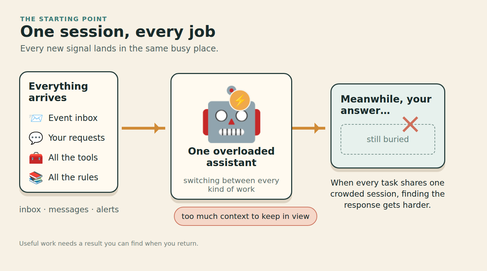
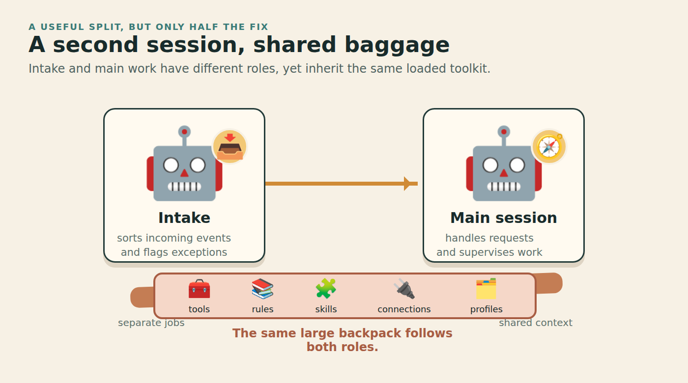
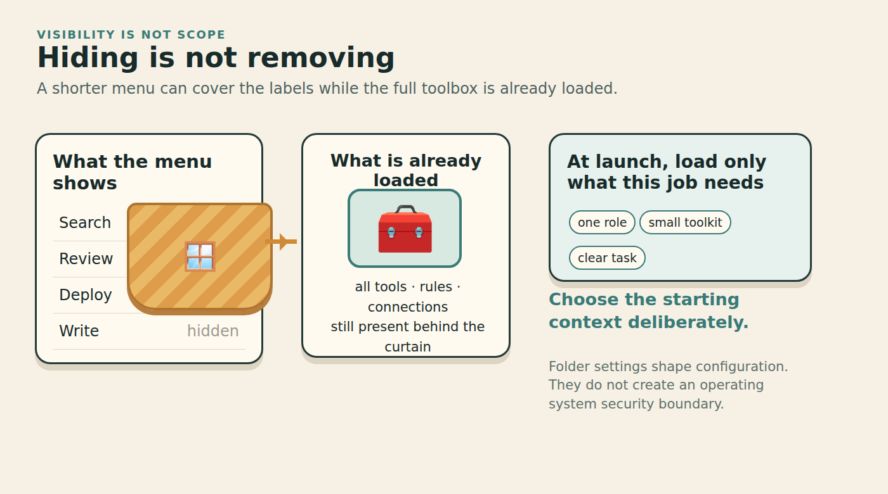
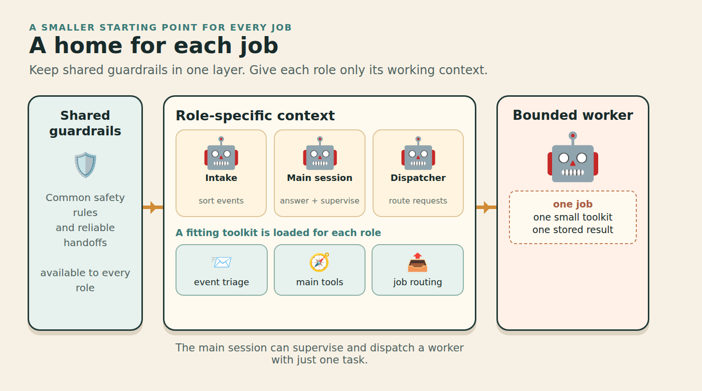
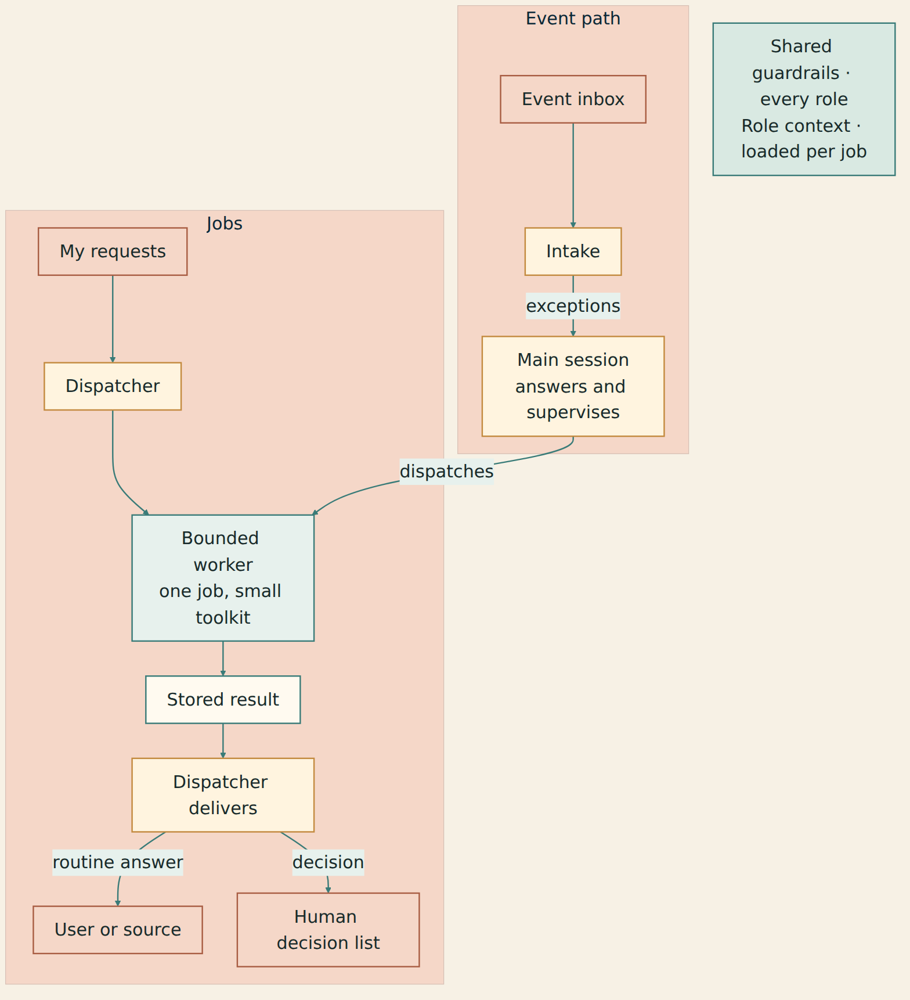
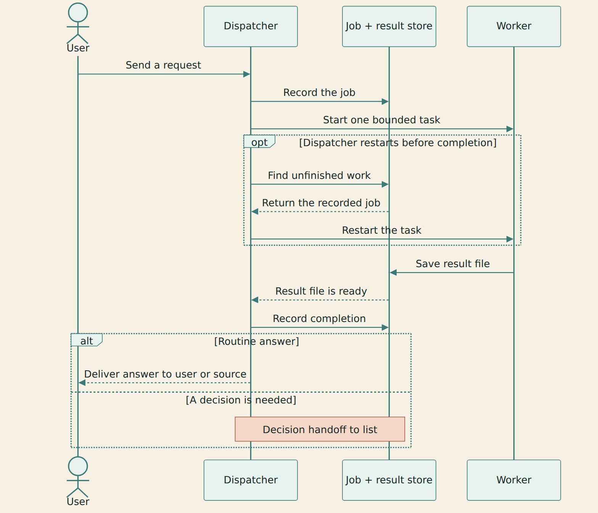

## Introduction

I came back to my AI assistant's terminal and could not find its answer. Notifications had pushed it out of view. The assistant had done the work. I still had to find it.

This was happening often enough that I told it: "the moment I cycle back, I never see your response". I move between messages, browser tabs, pull requests and terminal sessions. An answer that needs me to watch a pane at the right moment does not fit that loop.

The same assistant also watched incoming events, answered one-off questions, read logs, supervised workers and learned from my corrections. Every new responsibility brought tools and instructions. Its role file more than tripled in length in a little over a month. I had hired an assistant and given it my entire inbox.

> Hence a wealth of information creates a poverty of attention.
>
> Herbert A. Simon, [Designing Organizations for an Information-Rich World](https://gwern.net/doc/design/1971-simon.pdf), 1971

<!--truncate-->

In the [previous post](/blog/recursive-harness-self-improvement), I described a loop that turns the assistant's mistakes into hooks and tools with regression tests. That loop can improve individual mechanisms. I still had to decide which jobs belonged in the same session.

This post follows the attempts that led me to three roles: a main session that manages my attention and supervises work, an intake session that watches incoming events, and a dispatcher that handles one-off requests. Each needed its own context, memory and way to deliver results.

The dispatcher is a day old. My launch notes record smaller starting contexts, and the job store shows recovery after restarts. I still need to find out whether the split makes a working day cheaper or leaves me with fewer interruptions.

### Who is this blog for?

If you keep an AI agent running all day and every request, notification and lesson ends up in its conversation, this is for you. If you mostly ask a question and close the session, a second permanent agent may be another thing to maintain.

## Four attempts at a smaller job

### #1 More rules

My first response to a repeated mistake was to tell the assistant what it should do next time. The lesson became another paragraph in its instructions. Some lessons later became mechanisms through the improvement loop, but direct corrections could still accumulate as text.

The result was a role file that mixed a job description with operating procedures, exceptions and reminders. When a session needed to decide whether something required my attention, it also carried instructions for tasks it was not doing. Adding the next rule was easy. Deciding what no longer belonged there took work.

The missing answer made the limit visible. A rule saying "make your answer clear" cannot keep that answer from scrolling away under the next event. The delivery path had to change.

I gave finished work a place outside the conversation. A result needs a record that I can return to. If it leaves a step only I can take, it belongs on a separate decision list with the outcome, that one step, and enough context to act without opening the transcript.

"Here is the answer to your lookup" is a result. "The change is ready; you need to merge it" is a handoff. Sending both to a decision list turns an assistant's output back into an inbox of chores.

The instructions also needed a boundary. The role file now states the job and how the assistant should behave; procedures belong in skills loaded when needed. A size ceiling means each addition needs a cut elsewhere. I still have to judge whether the rules that remain help the assistant do its job.

### #2 A separate intake session

> Make each program do one thing well.
>
> M. D. McIlroy, E. N. Pinson and B. A. Tague, [UNIX Time-Sharing System: Foreword](https://mirror.math.princeton.edu/pub/unixarchive/Documentation/Papers/BSTJ/bstj57-6-1899.pdf), 1978

The next attempt was to move the event stream into an intake session. Its job is to check what happened, settle routine events at the source, and pass exceptions to the main session. A notification that a task finished is a reason to check its result, not proof that the work is done.

This gave the main session fewer reasons to wake up. It also gave each conversation a clearer purpose: incoming events in one, my decisions and ongoing work in the other.

But both sessions still started from the same working folder and inherited the same configuration. At one point a resume picked up the other session's conversation and identity. The hooks followed the wrong conversation. The windows were separate, but their configuration and conversation history were still entangled.

Giving each role its own working folder separated project history and local notes. It did not yet stop both loading the same collection of skills, plugins and tool servers. The intake session still loaded tools for every other job on the machine.

That was the next problem to measure. In a two-week census, the intake session had used one skill regularly and only a few others at all. Its skill menu contained dozens of entries. Most of that menu was there before an event arrived, whether intake needed it or not.

### #3 Tool profiles

I tried profiles that named the skills each role should use. They hid entries without reliably removing the other skills. A hidden skill could still be invoked by name, and plugin-provided skills did not all follow the same profile rules.

There are several surfaces to inspect: what the menu lists, what the model sees in context, what it can invoke directly, and what it can reach through another tool. A shorter menu answers only the first question.

Anthropic's [context-engineering guidance](https://www.anthropic.com/research/effective-context-engineering-for-ai-agents) treats context as a finite resource and warns about overlapping tool sets. It also describes focused subagents that work in their own context and return condensed findings. That helps explain the design; I would need separate evidence to judge answer quality in my setup.

Routing work away from the session was another way to reduce its load. I tried automatic quota routing, which estimated usage pressure and nudged work toward another runtime. Short bursts produced alarming forecasts; the warnings themselves woke sessions and consumed context. The control had become another source of work. I removed the quota gates and kept routing by capability. I now choose workers for the job they can do well.

The remaining change was more basic: decide what a role loads before it starts.

### #4 Separate launch configurations

> the only available technique for effective ordering of one's thoughts, that I know of.
>
> Edsger W. Dijkstra, on separation of concerns, [On the role of scientific thought](https://www.cs.utexas.edu/~EWD/transcriptions/EWD04xx/EWD447.html), 1974

Each role now starts from a folder containing its own instructions, selected skills, worker definitions and tool-server configuration. A launcher builds that folder from the role's profile. Shared guard hooks travel with it; removing an irrelevant skill must not remove a protection.

In Claude Code, the launch uses `--setting-sources project,local` to select project and local settings instead of user settings. MCP server selection is a separate concern: the CLI also has `--strict-mcp-config` for loading only an explicit server configuration. These flags have different jobs, and neither turns a folder into a sandbox. The [CLI reference](https://code.claude.com/docs/en/cli-reference) explains their scopes.

The global instructions stay short and shared. Role instructions refer to them, then describe that role's own job. A worker gets the procedures and context needed for its assignment. I do not want three copies of a rule slowly becoming three different rules.

The third role, a dispatcher, handles requests that belong to no ongoing stream: a question, a lookup, a command to run. It records a job, starts a bounded worker and delivers the result. The main session keeps the longer view and supervises work that crosses jobs. Intake keeps watching events while either is occupied.

Those roles have different useful lifetimes. Intake needs continuity across an event stream. Supervision needs continuity across decisions and workers. A one-off lookup should be able to finish without leaving its exploration in the main conversation for the rest of the day.

One dispatcher with short-lived workers could be enough in a simpler setup. I already had a continuous event stream and ongoing supervision to separate. That is how I arrived at three roles. A different workload may need fewer.

## Starting context

The token figures below are historical readings from my 7 November launch notes. I did not rerun them for this revision. The probe output survives, but I could not recover the original captures for the live comparisons. The notes record a headless intake launch on Haiku going from 57,546 to 48,875 tokens after its profile was applied.

The later folder changes also reached subagents, which start much more often than the main sessions. The notes include two examples of first-request context. Parentheses give the number of recorded runs; each probe is a separate single run after the change.

| Worker role | Before, live tokens (runs) | After, live tokens (runs) | Separate probe, tokens |
| --- | --- | --- | --- |
| History investigation | 47,174 (8) | 32,597 (4) | 22,989 |
| GitHub investigation | 52,748 (24) | 29,660 (1) | 21,698 |

These columns are not a replay of the same task. A real investigation and a short probe have different inputs, and the post-change sample is tiny. The readings suggest that the profile removed inherited context. They leave accuracy, total job cost and saved attention unmeasured.

Delegation can also cost more. In its own [multi-agent research system](https://www.anthropic.com/research/multi-agent-research-system), Anthropic reports much higher token use than ordinary chats and describes parallel research as a better fit than tightly dependent work. That result belongs to its system and evaluation. In mine, a smaller worker context still has to pay for the brief, the worker, the return and the supervisor reading it.

## Architecture

Each role owns a different stream of work, loads its own context and has a delivery path. The picture shows roles rather than the names of my running sessions. A shared set of guardrails sits underneath them; a smaller toolkit is not a new grant of authority.

Intake receives events and checks their source. An event that needs no action can settle there. An exception goes to the main session with evidence of what happened and what remains unresolved. Sending every event onward would recreate the original stream in another window.

The main session owns the longer-running work: priorities, exceptions, worker supervision and questions that cross assignments. It can delegate an investigation without importing every search result into its own context. Its job is still to assess the returned evidence and decide what follows.

The dispatcher owns a request from receipt to delivery. It records the request before starting a worker, including where the result should return. The worker receives one goal, the relevant context, the allowed actions and a result contract: what to answer, which evidence to include and where to save it.

The result contract asks for the command or source behind a claim and the output or passage that supports it. A sentence saying "checks passed" is not the check output. I can inspect the result, though an agent can still misread or invent evidence. Important conclusions still need verification at their source.

A routine answer returns to the place I asked from, with a stored result I can revisit. A decision handoff goes to the decision list. That list should contain finished work awaiting my step, not progress updates or a transcript of the assistant's day. Delivery is part of the job, and keeping a result is separate from interrupting me about it.

### Request delivery and restart recovery

One early request asked for a count of commits since midnight. It needed an answer. Yet the dispatcher had been sending routine results to my decision list as though I owed each one a decision. The first 17 requests include seven deliveries to that list and one rejection as a chore. I changed the dispatcher to answer in the pane by default; the records include ten answer deliveries.

The request is first written to an append-only job store. Dispatch records that a worker is starting, and the worker writes its result to a file. Completion lets the dispatcher read that file, judge whether it answers the request and choose the delivery path. The store keeps the state outside the conversation.

The first afternoon also included two jobs whose dispatching session restarted before they returned. Recovery requeued both on the next start. The next session could see unfinished work without remembering the conversation that created it. Requeuing is not proof of exactly-once execution. A worker that can make changes needs a way to detect an action already taken before repeating it.

There was a related surprise in a separate `/clear` experiment. Background work launched before the clear could finish and report into a fresh conversation that no longer knew what it had asked for. Clearing the parent's conversation had not cancelled its children. For this dispatcher, a fresh process after draining recorded work was easier to reason about than clearing a busy conversation.

The record of that first afternoon contains 17 requests, eight of them test probes. It shows mistaken handoffs, interrupted jobs and recovery, but cannot establish a success rate for real use.

### A small trial

You can test the idea without copying my launcher. Pick a read-only job you already do, such as investigating a failed check. Write down the question, where its evidence lives, what counts as a complete answer and where that answer should be saved. Give it to a separate worker with only the tools it needs. Keep the same model and task when comparing configurations.

Record the context at the first request, the final result, total usage and the time you spent briefing and reviewing. Repeat across several representative jobs. A short startup probe is useful for seeing what loads; a completed task is needed to see what the reduced setup can still do. Include a task that needs a rarely used tool, so a smaller profile cannot pass merely by avoiding its missing capability.

Then test delivery. Close the conversation and reopen it after the worker finishes. Check that you can find the result from the stored job alone. In a throwaway test, restart the dispatcher while a read-only job is running. Check that the next process can distinguish unfinished work from a completed result awaiting delivery. Watch what happens to the original worker as well as to the new session.

Only after that would I add continuous intake. A second permanent conversation adds routing, recovery and another place to look. It should remove a failure you can name.

## Security

Separating roles creates more places where text, tools and state cross a boundary. The checks below apply whether your system has two agents or twenty.

### Input trust

A worker may read a message that tells it to change its task, reveal data or contact another service. Passing that text through an intake agent does not make it trusted. The original source and the owner's request need to stay distinct throughout delegation, including in the worker's brief.

Check which inputs can create work, which can only supply evidence, and whether an instruction embedded in a retrieved document can change either. A supervisor's summary should preserve that distinction instead of laundering a stranger's request into its own authority.

### Effective permissions

A role-specific folder selects what normally loads. It does not, by itself, deny access to the rest of the machine or prevent a shell command from reaching a service whose dedicated tool was removed. Credentials, filesystem access and network access need their own controls. Claude Code documents its [shell sandbox](https://code.claude.com/docs/en/sandboxing) separately from settings and tool selection.

Check the effective permissions of the running role, including alternate tool paths and the credentials inherited by workers. Also check that narrowing the role did not drop the shared guard hooks. The shared protections need to survive the move.

### Retries and repeated actions

A read-only lookup is usually safe to retry. A worker that already submitted a change can do it twice if the dispatcher loses the completion record. An append-only store helps reconstruct events; it cannot undo an external action or make that action atomic with a local write.

Check how each job detects work already completed, how many retries it gets and when it stops for a person. Test the awkward interval after the action succeeds but before completion is recorded. Keep irreversible actions behind an explicit authority boundary.

### Spending limits

A supervisor can keep creating workers while each worker appears to make progress. Bound concurrency, queued work, runtime and attempts in the dispatch mechanism. A request in the prompt to be brief does not enforce a deadline.

Check every route that can start a worker, including shell jobs and other providers. Record dispatches that are refused as well as those that start. A job that keeps returning to the queue should become a visible failure, not an endless source of compute.

### Credentials and saved results

Generated settings and tool-server files can carry credentials, and a result file can contain the sensitive text a worker read. Moving them into per-role folders adds places to secure and exclude from version control.

Check file permissions, retention and backups, and what leaves the machine when a task goes to another provider. A small result is still a disclosure if it contains the wrong data.

## Observability

A crowded pane was visibly busy. Several quiet panes can hide a stalled stream. Silence is useful only if I can tell it from failure.

### Job lifecycle

For each job, retain when it was received, dispatched, completed and delivered, plus the result location. Look for jobs with a start and no completion, and results saved but never delivered. Recovery should say which jobs it requeued and why. These records let you investigate a failure without asking the agent to remember its own story.

Watch event freshness too. If events keep arriving but checked outcomes stop, the intake path may be stuck even when no process has crashed. The earlier improvement loop taught me that a skipped run or a message held by the wrong session can produce no error at all.

### Loaded context and tools

Use the runtime's context view after a fresh start, then inspect a real worker's first request. The role's menu, selected settings, effective tools and inherited worker context can differ. Repeat the check after a profile change or a runtime update, and run a task that needs one of the retained capabilities.

A startup count is a regression signal for configuration size. Pair it with completed-task results. The reduced setup still needs to finish the job.

### Attention and compute

My target is useful work advanced per unit of my attention and compute. I need to count completed jobs, unnecessary decision handoffs, results I could not find and times I had to intervene to keep work moving. My own corrections are another signal, provided I account for how much work the system attempted.

Those measures can disagree. Fewer complaints might mean fewer jobs, and fewer handoffs might mean stalled delivery. Read them together with the raw job records and sample the underlying work. The dispatcher should not be the only judge of whether its output was useful.

## Conclusion

The improvement loop in the previous post helped me turn corrections into mechanisms. Splitting the assistant meant looking at the jobs themselves: which needed continuity, which could end after one answer, and where those answers belonged. Separate launch configurations let me give each role a smaller starting context.

The launch notes and early job records give me a starting point. Whether the split gives back more attention than its upkeep consumes is still open.

Simon wrote about information consuming its recipients' attention. An assistant can sort that information and still consume mine if I have to find its answers, explain every handoff or supervise its restarts. Before you add another agent, choose the job it will own, the context it needs and the place its result will survive. Then check whether you have less work to do when you come back.
