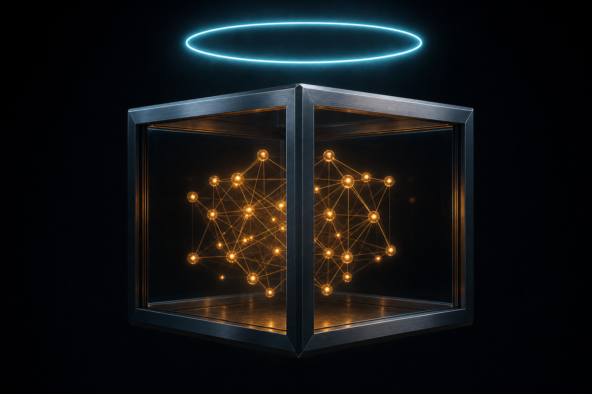
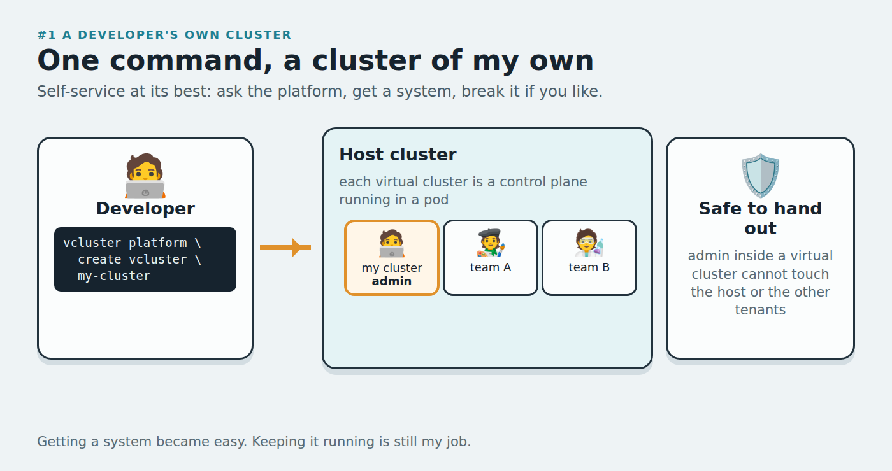
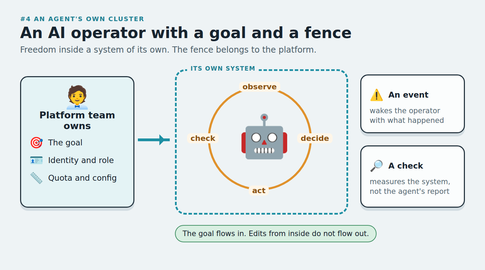
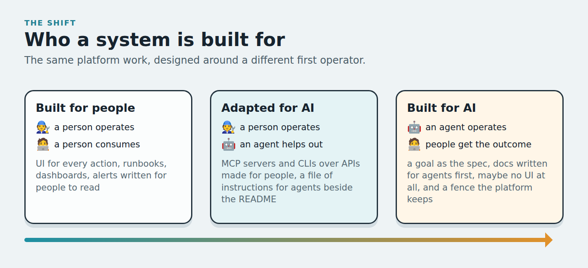

import ReactPlayer from 'react-player';

## Introduction

Every platform engineering and DevOps team I have worked on or led had the same goal: build self-service capabilities so developers could ship features with less friction.

That goal has not changed, but platform engineering is shifting under it, because more and more of its users are AI agents. An agent does not call an API once and walk away. It operates a system over time, and platform services now have to be designed for a user like that.

I call that kind of user an AI operator: an agent working toward a standing goal the platform team sets. The team decides what the agent can change. Within those limits, the agent watches the system, decides when to act, and checks whether its change moved the system toward the goal.

> The operator pattern aims to capture the key aim of a human operator who is managing a service or set of services.
>
> Kubernetes documentation, [Operator pattern](https://kubernetes.io/docs/concepts/extend-kubernetes/operator/)

<!--truncate-->

In the video, I showcase one possible scenario where an agent operates an isolated tenant cluster using [vCluster](https://github.com/loft-sh/vcluster), adapts to changing requirements and handles outages. The video shows the setup; this post follows the same journey and stays with the idea behind it.

<ReactPlayer controls src='https://www.youtube.com/watch?v=yWvU7jXGtPQ' style={{ width: '100%', height: 'auto', aspectRatio: '16 / 9' }} />

### Who is this blog for?

If you build internal platforms or run Kubernetes for other teams, and agents have started to show up as users, this is for you. You will see how the way we use a platform changes as AI joins in, step by step, until the agent runs a system of its own. Then I make the case that the systems we build next will be designed with an AI as their main operator.

## From my cluster to an agent's cluster

### #1 A developer's own cluster

The journey starts with what a platform already does well. A developer runs one command and gets a virtual cluster: a Kubernetes control plane running in a pod on a shared host. We normally avoid giving people admin rights on a cluster, because one wrong delete can hurt everyone on it. In a virtual cluster, admin is safe to hand out. The developer can install anything, break it and throw it away, and the host and the other tenants never notice.

That is self-service at its best. Getting a system became easy. Keeping it running is still the developer's job.

### #2 A developer using AI

Then we bring AI in, the way most of us started. I ask a model how to list what runs in my cluster. It answers with a `kubectl` command. I copy it, run it and paste the result back. The model never touches the cluster. I am the loop.

A second kind of model fits here too. A decision model does not write text; it answers one question about its input, yes or no, and how sure it is. I pipe my pods into one and ask whether they are all running. It is useful, and I am still the one doing every step.

### #3 AI that calls tools

Tools change that. Through [MCP](https://modelcontextprotocol.io) servers and CLIs an agent calls the system itself, so it stops guessing and starts acting. This is how most agents reach platforms today: a bot account and an API key, on a system built for people. A key like that works, but it was made for automation, not for an agent. We compensate by scoping it tightly and rotating it often.

The agent is now an execution proxy. It works faster than I do, but it holds a secret it borrowed, uses a shared cluster it cannot extend, starts every session from zero, and leaves behind objects nobody owns. I still decide when it runs and check what it did. I am still the operator.

### #4 An agent's own cluster

The last step takes me out of the loop. Instead of connecting an agent to my cluster, the platform gives the agent a cluster of its own and a job to do in it. The agent gets what a person on the team gets: an account, a key with only its rights, a system to operate and a goal. It observes the cluster, decides what to change, acts with its own key and checks the result. The platform team keeps the fence: the goal, the role, the quota and the cluster's config live where the agent cannot write.

In the video this agent is Tess. Its goal is a declarative artifact on the host, synced into its cluster as a read-only copy. From that goal Tess builds a small question board and deploys it. When I scale CoreDNS to zero, a Kubernetes warning wakes Tess, and Tess finds the cause and restores the service. When Tess edits its own goal from inside, the host puts the original back.

Tess stops being an execution proxy and becomes the custodian of the system it runs, across its whole life cycle. MCP gives an agent tools. A platform can give it a system to operate.

## Built for AI

> All service interfaces, without exception, must be designed from the ground up to be externalizable.
>
> Steve Yegge, recalling Jeff Bezos's API mandate at Amazon, [Stevey's Google Platforms Rant](https://gist.github.com/chitchcock/1281611), 2011

Tess ran on a platform built for people, and it fit because vCluster's building blocks happen to suit an agent: a cluster per tenant, a goal synced from the host, and work the platform tracks and removes as one. An agent operating a system that already exists is halfway there.

Extrapolate, and the next step is systems built from the start with an AI as their main operator and consumer. Amazon's API mandate is a useful analogy. In Yegge's account, around 2002 every team had to design its interfaces from the ground up for developers outside the company, and designing for that new consumer changed what those systems were. I expect designing for an AI operator to change ours.

Most of what we have today sits in the middle. Agents use the same APIs we do, and an MCP server is an overlay on access points built for people. [AGENTS.md](https://agents.md) gives coding agents a file beside the README, because, as its site puts it, "README.md files are for humans". [kagent](https://kagent.dev), [K8sGPT](https://k8sgpt.ai) and [HolmesGPT](https://holmesgpt.dev) bring agents to Kubernetes. All of them adapt systems made for people.

A system built for an AI operator starts from the other end. Its intent is a goal in plain language that the platform stores. Its interface is APIs, events and text, with views for people on top or no UI at all. Its operator's authority is written down as an identity, a scoped key and a fence. The platform keeps its memory between sessions. Its signals start sessions instead of waking people.

## What stays with people

> The second irony is that the designer who tries to eliminate the operator still leaves the operator to do the tasks which the designer cannot think how to automate.
>
> Lisanne Bainbridge, [Ironies of Automation](https://doi.org/10.1016/0005-1098(83)90046-8), 1983

Bainbridge wrote about industrial process control, long before language models, and the warning still applies. If we hand the operator's job to agents without deciding what people keep, people end up with the leftovers. I would decide it on purpose. People own the goal, the fence and the check that says whether the system meets its goal, measured apart from the agent's own report.

## Conclusion

Agents are turning from users of our systems into their operators, and I think the systems we build next will be designed with an agent as their first operator and consumer. Platform engineering keeps its goal of self-service with less friction. What self-service means for an agent is a goal, an identity, a system of its own and a fence it cannot move.

I do not know yet how far this goes. My demo is one agent, one small application and one outage I caused on purpose. The question I keep coming back to is what a system with no human interface must expose so that people can still trust it.

If you want to try it, pick one goal your team handles by hand today, pager included, and give it to an agent with a system of its own. Then ask what you would have designed differently if that system had been built for the agent from the start.
