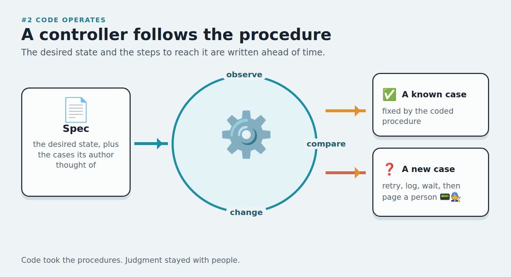
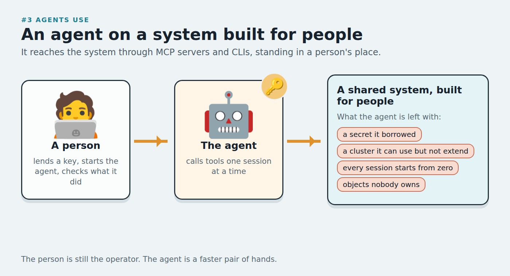
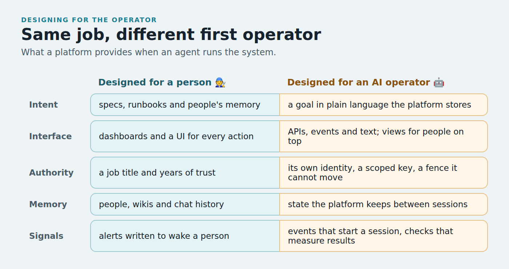

## Introduction

Every platform engineering and DevOps team I have worked on or led had the same goal: build self-service capabilities so developers could ship features with less friction.

That goal has not changed, but platform engineering is shifting under it, because more and more of its users are AI agents. An agent does not call an API once and walk away. It operates a system over time, and platform services now have to be designed for a user like that.

I call that kind of user an AI operator: an agent working toward a standing goal the platform team sets. The team decides what the agent can change. Within those limits, the agent watches the system, decides when to act, and checks whether its change moved the system toward the goal.

> The operator pattern aims to capture the key aim of a human operator who is managing a service or set of services.
>
> Kubernetes documentation, [Operator pattern](https://kubernetes.io/docs/concepts/extend-kubernetes/operator/)

<!--truncate-->

Operators are not new to anyone who runs Kubernetes. The word already stands for software that does part of a person's job. What is new is that the whole job, judgment included, can now sit with an agent. Once it does, a system no longer has to be designed around a person at a console. It can be designed around the agent that runs it, with people as the ones who set its goals and get its results. That is the shift I want to describe, and I think it will change how we build platforms more than any single tool will.

In the [video](https://www.youtube.com/watch?v=yWvU7jXGtPQ) I show one possible scenario: an agent operates an isolated tenant cluster on [vCluster](https://github.com/loft-sh/vcluster), adapts to changing requirements and handles an outage. The video walks through the setup step by step. This post stays with the idea behind it.

Earlier this year, in [Your Platform Already Has AI Users](/blog/ai-agent-platform-engineering), I mapped the CNCF platform model onto agents as consumers of a platform. This post takes the next step, from agents that use a system to agents that operate one.

### Who is this blog for?

If you build internal platforms, run Kubernetes for other teams, or design products that agents already touch, this is for you. You will see how the operator of a system moved from people to code to agents, what changes when you design a system with an agent as its first operator, and which parts of the job I think should stay with people.

## Who operates the system

Each step below kept what worked before it and moved one more part of the operator's job.

### #1 People operate

Platforms started as systems people run for people. A developer asks through a portal, a form or a ticket. An engineer follows a runbook. Someone carries the pager. Every interface is made for human eyes: a UI for each action, dashboards to watch, alerts written for a person to read at 3 a.m.

Platform engineering made the asking part fast. A developer can get a cluster with one command, break it and throw it away without asking anyone. Keeping the platform itself running stayed a person's job, and the design shows it. Runbooks assume someone knows where to look. Much of the context lives in people's heads.

### #2 Code operates

Kubernetes moved a large part of operations into code. A controller watches the actual state of a resource, compares it with the desired state and changes what differs. An operator does the same for one application and packs what a human operator knows about it into that loop: how to deploy it, scale it, back it up and recover it.

This works very well for everything its author foresaw. The desired state is written ahead of time, and so is the procedure for each case. When something happens that nobody wrote a case for, the controller retries, logs and waits until a person gets paged. Code took the procedures. Judgment stayed with people.

### #3 Agents use

Then agents started to call the same APIs people call. Through [MCP](https://modelcontextprotocol.io) servers and CLIs they read logs, run pipelines, open pull requests and query clusters. MCP servers and CLIs are how an agent reaches a system, and they are here to stay. What matters for this post is the position the agent is put in.

Most agents I see get in with a bot account and a key someone lent them, on a system designed for people. It works, the way a robot arm can type on a keyboard. It also leaves the agent holding a secret that belongs to someone else, on a shared cluster it can use but not extend. It starts every session from zero, and what it builds is a pile of objects nobody owns. A person still decides when the agent runs and checks what it did. The person is still the operator.

### #4 Agents operate

The next step is to hand the agent the job itself. An AI operator gets what a new person on the team gets: an identity of its own, a key with only its rights, a system to run and a goal. It reads the goal, looks at the system, decides what to change, makes the change with its own key and checks whether the system moved toward the goal. Then it goes round again.

The loop looks like the one a Kubernetes controller runs. What drives it is different. A controller follows a spec and a procedure someone wrote in advance. An AI operator follows a goal written in plain language and works out the procedure when it needs one. That brings the judgment that code could not take into the loop, including for the case nobody wrote down.

In the video the agent is called Tess. The platform team gives Tess an account, a key and a virtual cluster of its own, and writes Tess's goal on the host cluster, where Tess cannot edit it. From one paragraph of goal Tess builds a small application. When I break DNS in its cluster, a Kubernetes warning wakes Tess, and Tess finds the cause and fixes it. When Tess rewrites its own goal from inside the cluster, the host puts the original back.

## Systems built for their operator

> All service interfaces, without exception, must be designed from the ground up to be externalizable.
>
> Steve Yegge, recalling Jeff Bezos's API mandate at Amazon, [Stevey's Google Platforms Rant](https://gist.github.com/chitchcock/1281611), 2011

Tess ran on a platform built for people, and it fit because the platform's building blocks happened to suit an agent: a cluster per tenant, a goal synced from the host, and a unit of work the platform tracks and removes as one. An agent operating a system that already exists is halfway there.

Extrapolate, and the next step is systems built from the start with an AI as their main operator and consumer. I find Amazon's API mandate a useful analogy here. In Yegge's account, around 2002 Bezos told every team to expose its data and functionality through service interfaces, and to design each one so it could be opened to developers outside the company. Designing for a new kind of consumer from the ground up changed what those systems were. I expect designing for an AI operator to do the same.

Some of it is already visible. [AGENTS.md](https://agents.md), an open format now stewarded by the Agentic AI Foundation, gives coding agents a file of their own beside the README; its site puts the reason plainly: "README.md files are for humans". Projects such as [kagent](https://kagent.dev), [K8sGPT](https://k8sgpt.ai) and [HolmesGPT](https://holmesgpt.dev) bring agents to Kubernetes. Both are systems built for people and adapted for AI. The step after that is a system whose first operator is an agent, where people get the outcome and a way to inspect it.

What would you design differently if you knew an agent would run the system? This is where my thinking is today.

### The goal becomes the spec

Today the intent of a system is spread across specs, runbooks, alert descriptions and the memory of whoever built it. For an AI operator, intent can be written once, as a goal in plain language, and the agent works out the steps. The platform's job is to keep that goal versioned, owned and delivered to the agent when it changes. In the demo, the on-call duty is one sentence of Tess's goal. There is no separate alerting design behind it.

### The interface is text and state

An agent reads APIs, events, logs and files. It does not need a dashboard, and a person who wants one can have a view built on the same state. I expect systems built for AI to look alien to us: documentation written for agents first, maybe no UI at all. That is fine as long as the people who depend on them can see what the system did and why.

### Authority is explicit, and the fence belongs to the platform

A person's authority comes from a role, a team and years of trust. An agent's authority has to be written down: an identity of its own, a key scoped to its role and set to expire, and a system it can break without breaking anyone else's. Everything that decides what kind of user the agent is (its goal, its role, its quota, the config of the system it runs) lives where the agent cannot write. Inside that fence the agent can have more freedom than we usually give a person, because the blast radius ends at its own system.

### The platform remembers, sessions are disposable

An agent starts each session from zero unless something keeps its state. In a system built for an AI operator, the platform holds what matters between sessions: the goal, what the agent built as one tracked unit, and a record of what it did. The agent can be restarted, replaced or moved to another model, and the system carries on.

### Signals are written for a machine reader

Alerts today are written to wake a person. For an AI operator, events are input: a warning becomes the start of a new session, with the event in its prompt. The checks that matter most measure the system on their own terms, separately from what the agent reports, so you can compare the two and read the sessions where they disagree.

## What stays with people

> The second irony is that the designer who tries to eliminate the operator still leaves the operator to do the tasks which the designer cannot think how to automate.
>
> Lisanne Bainbridge, [Ironies of Automation](https://doi.org/10.1016/0005-1098(83)90046-8), 1983

Bainbridge wrote about industrial process control, decades before language models. Her point still holds. If we hand the operator's job to agents without deciding what people keep, people end up with whatever was left over, and little thought goes into supporting them in it.

So I would decide it on purpose. In the systems I want to build, people own three things. They own the goal: what the system is for, written so an agent can act on it and changed when the business changes. They own the fence: the identity, the role, the quota and the config, kept where the agent cannot write, and tested from the inside by trying to change them as the agent and watching the change get undone. And they own the check that says whether the system meets its goal, independent of the agent's own summary.

A few things I would carry into any setup like this. Treat everything the agent reads as data, because a goal, an event or a user's message can carry instructions. A small decision model can filter those, but filtering lowers the risk without removing it, so the agent's own permissions should stay small too. Give the agent a runtime that carries nothing from the machine it runs on except its own key. And keep a log of every action the agent takes that a person can read afterwards, because that log is how you learn where your goal was unclear.

This is the same move platform teams made once already. We stopped closing tickets by hand and started building the products that close them. With AI operators, we stop running the systems ourselves and start writing the goals, fences and checks that let an agent run them.

## Conclusion

My view is that agents are turning from users of our systems into their operators, and that the systems we build next will be designed with an agent as their first operator and consumer. Platform engineering keeps its goal of self-service with less friction. Who it serves is changing, and so is what self-service means for them: a goal, an identity, a system of its own and a fence it cannot move.

I do not know yet how far this goes. The demo is one agent, one small application and one outage I caused on purpose. I have no data on how often an AI operator fixes the wrong thing, or on what a fence misses in a platform much bigger than mine. The question I keep coming back to is what a system with no human interface must expose so that people can still trust it.

If you want to try it, pick one goal your team handles by hand today, pager included. Write it as a goal an agent could follow, give the agent an identity and a system of its own, put the goal where the agent cannot edit it, and write the check that tells you whether it worked. Then ask yourself what you would have designed differently if that system had been built for the agent from the start.
